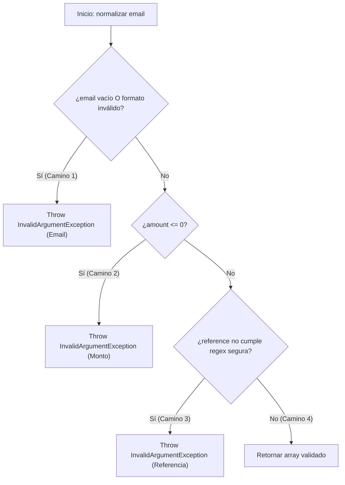
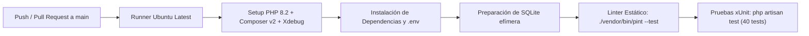

# 🧪 DOCUMENTACIÓN TÉCNICA: DETERMINACIÓN DE FALLAS CON CAJA NEGRA, CAJA BLANCA, PRUEBAS xUNIT, DOBLES DE PRUEBA E INTEGRACIÓN CONTINUA

- **Institución:** Fundación de Estudios Superiores Comfanorte (FESC)
- **Programa:** Ingeniería de Software
- **Asignatura:** Codificación y Pruebas del Software
- **Competencia / Resultado:** Determinar fallas con técnicas de caja negra y caja blanca, pruebas xUnit, dobles de prueba e integración continua.
- **Proyecto Aplicado:** `citas-app` (Plataforma de Gestión de Citas Estéticas y Pagos)
- **Autores:** Erick Cuevas y Camilo Ramírez

---

## 1. Determinación de Fallas con Técnicas de Caja Negra (*Black-Box Testing*)

Las pruebas de **Caja Negra** (también llamadas funcionales o basadas en especificaciones) evalúan el comportamiento externo del sistema verificando sus entradas y salidas sin depender de la estructura interna del código. En `citas-app` se aplicaron cuatro técnicas formales para detectar fallas:

### 1.1. Partición de Equivalencia (*Equivalence Partitioning*)
Divide el dominio de datos de entrada en clases válidas (que deben ser aceptadas) y clases inválidas (que deben ser rechazadas de forma controlada):

| Módulo / Método | Entrada Evaluada | Partición Válida (Aceptada) | Partición Inválida (Falla / Rechazo Controlado) | Prueba Automatizada que lo Verifica |
| :--- | :--- | :--- | :--- | :--- |
| `AppointmentPaymentService::validateTransactionPayload()` | `amount` (Monto de pago) | Valores reales $> 0$ (ej. `75000.00`) | Valores $\le 0$ (ej. `0`, `-50000`) | `test_validate_defensive_transaction_rejects_non_positive_amount` |
| `AppointmentPaymentService::validateTransactionPayload()` | `email` (Correo del pagador) | Formato RFC válido (`cliente@fesc.edu.co`) | Sin usuario/dominio o doble `@` (`correo-invalido@@dominio`) | `test_validate_defensive_transaction_rejects_malformed_email` |
| `AppointmentPaymentService::validateTransactionPayload()` | `reference` (Referencia PSE/Pago) | Alfanumérico de 3 a 60 caracteres (`PSE-2026-001`) | Caracteres de inyección SQL/XSS (`PSE-001'; DROP TABLE...`) | `test_validate_defensive_transaction_rejects_disallowed_characters_in_reference` |
| `HolidayController::sync()` | `country_code` (Código ISO país) | Código alfabético de 2 letras (`CO`) | Secuencias de *Path Traversal* (`../../malicious`) | `test_holiday_sync_api_validates_country_code_format` |
| `ValidatesAppointmentPayload::appointmentRules()` | `start_time` (Hora de cita) | Formato 24h `H:i` (`09:00`, `10:30`) | Horas inexistentes (`99:99`) | `test_invalid_start_time_returns_validation_error` |

### 1.2. Análisis de Valores Límite (*Boundary Value Analysis - BVA*)
Dado que la mayoría de las fallas ocurren en las fronteras de las particiones de equivalencia, se diseñaron pruebas específicas sobre los límites exactos:

1. **Frontera del Horario de Apertura Comercial (`08:00`):**
   - Un negocio abre a las `08:00:00` y cierra a las `18:00:00`. Se verifica el valor límite inferior exacto (`start_time = '08:00'`) para confirmar que el operador relacional sea inclusivo (`>=` y no `>`) en `test_client_can_create_appointment_at_exact_opening_time`.
2. **Frontera de Traslape de Citas (`09:00` - `09:30`):**
   - Si existe una cita entre `09:00` y `09:30`, cualquier solicitud que inicie en el intervalo `[09:00, 09:29]` (por ejemplo, `09:15`) es rechazada por colisión temporal en `test_appointment_cannot_overlap_another_appointment`.
3. **Frontera de *Rate Limiting* en Autenticación (Límite = 5 intentos):**
   - Los intentos fallidos $1, 2, 3, 4, 5$ retornan error de credenciales, y en el **intento $6$** (límite superior + 1) el sistema bloquea la petición por fuerza bruta (`test_login_is_rate_limited_after_repeated_failures` en `tests/Feature/AuthFlowTest.php`).

### 1.3. Pruebas de Transición de Estados (*State Transition Testing*)
El ciclo de vida de una cita (`Appointment`) sigue una máquina de estados finita:
- `pending` $\xrightarrow{\text{pago de anticipo}}$ `confirmed` $\xrightarrow{\text{servicio prestado}}$ `completed` (Estado cerrado).
- `pending` / `confirmed` $\xrightarrow{\text{cancelación}}$ `cancelled` (Estado cerrado).
- **Regla de falla detectada:** Una cita en estado cerrado (`completed` o `cancelled`, verificado por `Appointment::isClosed()`) no puede volver a editarse ni recibir pagos duplicados (`AppointmentTest::test_is_closed_returns_true_for_completed_or_cancelled`).

---

## 2. Determinación de Fallas con Técnicas de Caja Blanca (*White-Box Testing*)

Las pruebas de **Caja Blanca** (estructurales) inspeccionan el código fuente interno, sus estructuras condicionales, ramas lógicas y caminos de ejecución.

### 2.1. Grafo de Flujo de Control y Complejidad Ciclomática $V(G)$
Analizando el método `AppointmentPaymentService::validateTransactionPayload()` en [`app/Services/AppointmentPaymentService.php`](app/Services/AppointmentPaymentService.php):

```php
public function validateTransactionPayload(string $email, float $amount, string $reference): array
{
    $normalizedEmail = strtolower(trim($email));

    // Decisión D1 (Compuesta: predicado P1 || predicado P2)
    if ($normalizedEmail === '' || filter_var($normalizedEmail, FILTER_VALIDATE_EMAIL) === false) {
        throw new InvalidArgumentException('El correo electronico del pagador no tiene un formato valido.');
    }

    // Decisión D2 (Predicado P3)
    if ($amount <= 0) {
        throw new InvalidArgumentException('El monto del pago debe ser estrictamente mayor a cero.');
    }

    $normalizedReference = trim($reference);

    // Decisión D3 (Predicado P4)
    if (preg_match(self::SAFE_REFERENCE_PATTERN, $normalizedReference) !== 1) {
        throw new InvalidArgumentException('La referencia de pago contiene caracteres no permitidos.');
    }

    // Camino de éxito
    return [
        'email' => $normalizedEmail,
        'amount' => round($amount, 2),
        'reference' => $normalizedReference,
    ];
}
```



- **Cálculo de Complejidad Ciclomática de McCabe:**
  $$V(G) = D + 1 = 3 + 1 = 4 \quad \text{(o } V(G) = P + 1 = 5 \text{ considerando el cortocircuito lógico)}$$
- **Cobertura de Caminos Básicos y Ramas (100%):**
  1. **Camino 1 ($D_1 = \text{True}$):** Cubierto por `test_validate_defensive_transaction_rejects_malformed_email`.
  2. **Camino 2 ($D_1 = \text{False}, D_2 = \text{True}$):** Cubierto por `test_validate_defensive_transaction_rejects_non_positive_amount`.
  3. **Camino 3 ($D_1 = \text{False}, D_2 = \text{False}, D_3 = \text{True}$):** Cubierto por `test_validate_defensive_transaction_rejects_disallowed_characters_in_reference`.
  4. **Camino 4 ($D_1 = \text{False}, D_2 = \text{False}, D_3 = \text{False}$):** Cubierto por `test_validate_defensive_transaction_accepts_valid_payload`.

### 2.2. Análisis de Ramas en Disponibilidad (`AppointmentAvailabilityService::isWithinBusinessHours`)
En [`app/Services/AppointmentAvailabilityService.php`](app/Services/AppointmentAvailabilityService.php), el método evalúa secuencialmente:
1. Si `$checkHoliday && $this->isHoliday($date)` $\to$ retorna `false`.
2. Si no existe horario activo (`! $businessHour`) para ese día de la semana $\to$ retorna `false`.
3. Comparación aritmética en minutos: `toMinutes($startTime) >= toMinutes($opens_at) && toMinutes($endTime) <= toMinutes($closes_at)`.

---

## 3. Arquitectura de Pruebas con Herramientas Tipo xUnit (PHPUnit 11.5)

El proyecto implementa el estándar de arquitectura **xUnit** mediante **PHPUnit 11.5**, configurado en [`phpunit.xml`](phpunit.xml):

### 3.1. Componentes de la Arquitectura xUnit en el Proyecto
1. **Test Runner y Configuración (`phpunit.xml`):**
   - Define dos *Test Suites* separadas: `<testsuite name="Unit">` (`tests/Unit`) y `<testsuite name="Feature">` (`tests/Feature`).
   - Configura variables de entorno aisladas para pruebas (`DB_CONNECTION=sqlite`, `DB_DATABASE=:memory:`, `SESSION_DRIVER=array`, `BCRYPT_ROUNDS=4`) garantizando ejecuciones deterministas y rápidas (~6 segundos para 40 pruebas).
2. **Test Case Base y Fixtures (`Tests\TestCase` y `RefreshDatabase`):**
   - Las pruebas unitarias puras extienden `PHPUnit\Framework\TestCase` (sin levantar el contenedor de base de datos).
   - Las pruebas de integración/regresión extienden `Tests\TestCase` y usan el trait `RefreshDatabase` junto con *Model Factories* (`User::factory()->client()->create()`) para reconstruir el estado limpio antes de cada método `test_*`.
3. **Estructura *Arrange - Act - Assert (AAA)*:**
   - **Arrange (Preparar):** Instanciación de entidades, servicios o dobles de prueba.
   - **Act (Actuar):** Invocación del método bajo prueba o petición HTTP (`$this->actingAs(...)->post(...)`).
   - **Assert (Afirmar):** Verificación del resultado mediante aserciones xUnit (`assertEquals`, `assertSame`, `assertTrue`, `expectException`, `assertDatabaseHas`, `assertJsonPath`).

---

## 4. Dobles de Prueba (*Test Doubles*: Mocks, Stubs y Fakes)

Para aislar el código bajo prueba de dependencias externas lentas, no deterministas o con efectos secundarios (como pasarelas OAuth2 de Google, APIs públicas de festivos en Internet o el disco duro físico), el proyecto implementa **tres tipos de Dobles de Prueba**:

### 4.1. *Mocks* con `Mockery` (Verificación de Comportamiento en Google OAuth)
En [`tests/Feature/AuthFlowTest.php`](tests/Feature/AuthFlowTest.php), se utilizan objetos **Mock** mediante la librería `Mockery` para reemplazar el proveedor externo `Laravel\Socialite\Contracts\Provider` y verificar que los métodos `driver('google')`, `redirect()` y `user()` sean invocados exactamente una vez (`once()`):

```php
$provider = Mockery::mock(Provider::class);
$socialiteUser = Mockery::mock(SocialiteUser::class);

$socialiteUser->shouldReceive('getId')->andReturn('google-123');
$socialiteUser->shouldReceive('getEmail')->andReturn('google-user@example.com');
$socialiteUser->shouldReceive('getName')->andReturn('Google User');
$socialiteUser->shouldReceive('getAvatar')->andReturn('https://example.com/avatar.png');

$provider->shouldReceive('user')->once()->andReturn($socialiteUser);

Socialite::shouldReceive('driver')
    ->once()
    ->with('google')
    ->andReturn($provider);
```

### 4.2. *Stubs* de Red HTTP (`Http::fake`) para Consumo de APIs Externas
En [`tests/Feature/HolidaySyncTest.php`](tests/Feature/HolidaySyncTest.php), se utiliza `Http::fake()` como **Stub de red** para interceptar las llamadas salientes hacia `https://date.nager.at/api/v3/PublicHolidays/*` y simular dos escenarios deterministas sin requerir conexión a Internet:
1. **Escenario exitoso (HTTP 200):** Retorna un payload JSON controlado con 2 festivos de Colombia (`2026-07-20` y `2026-08-07`) y comprueba que se persistan en la tabla `holidays`.
2. **Escenario de falla del proveedor externo (HTTP 500):** Simula una caída del servidor externo y verifica que `HolidaySyncService` capture la falla y responda con un código controlado `502 Bad Gateway`.

### 4.3. *Fakes* de Almacenamiento (`Storage::fake`) para Pruebas de Seguridad
En [`tests/Feature/SecurityHardeningTest.php`](tests/Feature/SecurityHardeningTest.php), se emplea `Storage::fake('public')` para reemplazar el sistema de archivos real por un disco virtual en memoria. Esto permite crear archivos señuelo (`services/1/legit.jpg` y `foreign_folder/victim.jpg`) y demostrar con `assertMissing()` y `assertExists()` que un usuario malintencionado no puede borrar imágenes de otros negocios (mitigación de vulnerabilidad **IDOR**).

---

## 5. Integración Continua (CI) con GitHub Actions

El proyecto cuenta con un flujo de **Integración Continua (CI)** automatizado en [`.github/workflows/tests.yml`](.github/workflows/tests.yml), el cual se ejecuta automáticamente ante cada evento `push` o `pull_request` sobre la rama principal `main`.

### 5.1. Arquitectura del Pipeline de Integración Continua



### 5.2. Etapas Verificadas por el Pipeline ([`.github/workflows/tests.yml`](.github/workflows/tests.yml))
1. **Aprovisionamiento del Entorno (`actions/checkout@v4` y `shivammathur/setup-php@v2`):** Configura PHP `8.2`, Composer v2 y el motor de cobertura `xdebug`.
2. **Construcción e Instalación Limpia:** Copia `.env.example` a `.env`, instala dependencias con `composer install --prefer-dist`, genera la llave criptográfica (`php artisan key:generate`) y crea la base de datos SQLite limpia.
3. **Puerta de Calidad 1 — Análisis Estático / Linter (`./vendor/bin/pint --test`):** Verifica que ningún cambio viole el estándar de codificación **PSR-12**.
4. **Puerta de Calidad 2 — Ejecución de Suite xUnit (`php artisan test`):** Ejecuta las **40 pruebas automatizadas (144 aserciones)** entre pruebas unitarias, de caja negra, de caja blanca, dobles de prueba y regresión. Si alguna prueba o regla del linter falla, el pipeline bloquea la integración devolviendo un código de salida distinto de cero.
