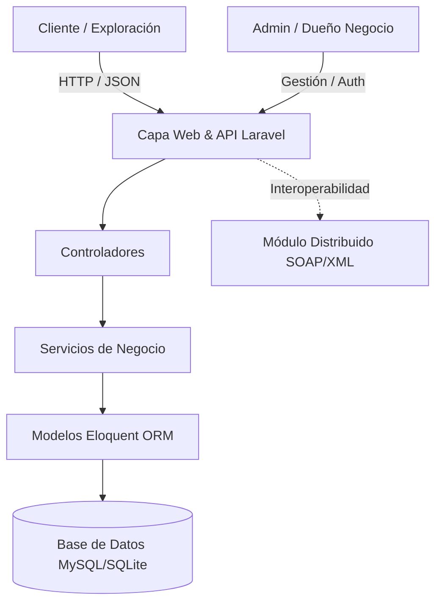

---
tags:
  - moc
  - arquitectura
  - sistema
  - citas-app
actualizado: 2026-09-22
version: 1.0.0
autores: Erick Cuevas & Camilo Ramirez
asignatura: Cliente-Servidor
framework: Laravel 11 / PHP 8.3+ / Vite / TailwindCSS
---

# 🧭 MOC - Índice Maestro del Proyecto: Citas-App

Bienvenido a la **Bóveda de Mapeo de Arquitectura y Conocimiento** de **citas-app** (Plataforma de reserva de citas para estética y belleza).

Esta bóveda de Obsidian contiene el mapeo multidimensional de la aplicación: capas de software, modelos de datos, ruteo, flujo de citas, módulos distribuidos y trazabilidad académica.

---

## 🗺️ Mapa de Contenidos Principal

| Documento | Descripción | Enlace |
| :--- | :--- | :--- |
| **Arquitectura Visual** | Lienzo Canvas interactivo con todas las capas y flujos | [[Arquitectura-General.canvas]] |
| **01. Arquitectura y Capas** | Desglose MVC, modelo Cliente-Servidor y separación lógica | [[01 - Arquitectura y Capas del Sistema]] |
| **02. Rutas y Endpoints** | Catálogo de rutas Web, API REST y middlewares de seguridad | [[02 - Mapa de Rutas y Endpoints]] |
| **03. Modelo de Datos** | Diagrama Entidad-Relación, tablas, campos y migraciones | [[03 - Modelo de Datos y Esquema ER]] |
| **04. Lógica de Negocio** | Ciclo de vida de citas, cálculo de disponibilidad y pagos | [[04 - Logica de Negocio y Flujos]] |
| **05. Servicios e Integraciones** | Servicios especializados (`Availability`, `Payment`, `HolidaySync`) | [[05 - Servicios e Integraciones]] |
| **06. Módulo Distribuido** | Arquitectura SOAP, RPC, XML/XSLT y Registry | [[06 - Modulo Distribuido y SOAP]] |
| **07. Guías Académicas** | Trazabilidad con Guía 1 (Capas), Guía 2 (Interoperabilidad), Guía 7 | [[07 - Guias y Actividades Academicas]] |
| **08. Bitácora de Decisiones** | Registro de decisiones arquitectónicas (ADR) y memoria técnica | [[08 - Bitacora de Decisiones (ADR) y Memoria]] |

---

## 📦 Entidades y Modelos de Datos

Acceso rápido a las fichas técnicas individuales de cada entidad Eloquent:

- 👤 [[entidades/User|User (Usuario / Roles: Client, Business, Admin)]]
- 🏢 [[entidades/Business|Business (Negocio / Salón de Estética con Branding)]]
- 💅 [[entidades/Service|Service (Servicio de Belleza con Galería y Precios)]]
- 📅 [[entidades/Appointment|Appointment (Cita, Horario y Estado)]]
- ⏰ [[entidades/BusinessHour|BusinessHour (Horarios de Atención Semanal)]]
- 🏖️ [[entidades/Holiday|Holiday (Días Feriados e Inhábiles)]]
- ⭐ [[entidades/BusinessReview|BusinessReview (Reseñas Verificadas y Calificación)]]

---

## 🛠️ Herramientas de Mapeo y Automatización
- **Sincronizador**: Ejecuta `powershell -File .\scripts\sync-obsidian-map.ps1` para refrescar métricas y detectar nuevas rutas o modelos.
- **Agente de Memoria**: La IA tiene integrada la skill `.agents/skills/project-memory-mapper` para consultar esta bóveda y registrar cada nueva característica desarrollada.
