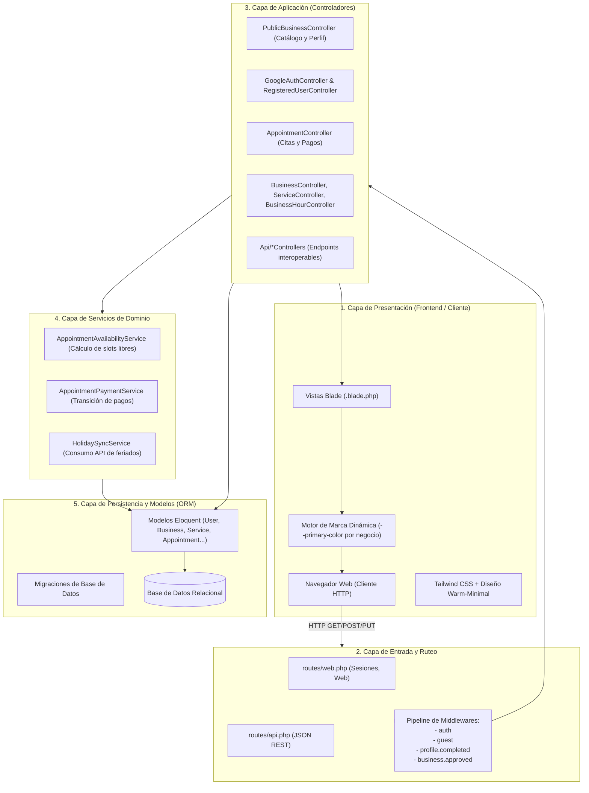

---
tags:
  - arquitectura
  - capas
  - cliente-servidor
  - mvc
padre: "[[00 - MOC - Indice Maestro]]"
---

# 🏛️ 01 - Arquitectura y Capas del Sistema

Este documento describe el modelo arquitectónico de capas de **citas-app**, alineado con los principios de diseño de software y la **Guía 1 - Actividad 3: Análisis de Capas** de la materia *Cliente-Servidor*.

---

## 📐 Diagrama de Capas de la Aplicación

---

## 🔍 Detalle de Cada Capa

### 1. Capa de Presentación (Frontend)
- **Tecnología**: Motor de plantillas Laravel Blade + Tailwind CSS + Vanilla JS / Alpine.
- **Identidad Visual**: Warm-minimal (Terracota, crema, serif editorial Cormorant Garamond para titulares e Inter para UI).
- **Personalización de Marca**: Cada negocio puede definir su color corporativo en la base de datos (`primary_color`). Este color se inyecta dinámicamente como variable CSS `--primary-color` solo en las vistas del negocio público, garantizando que no contamine la identidad global de la plataforma.
- **Componentes Reutilizables**: Tarjetas de servicio con galería, selector interactivo de horarios disponibles, estados de reserva con pills tipográficas accesibles.

### 2. Capa de Ruteo y Middleware
- Separa estrictamente el protocolo HTTP de la lógica de negocio.
- **Filtros de Seguridad por Middleware**:
  1. `guest`: Protege formularios de registro y login.
  2. `auth`: Exige sesión iniciada para operaciones privadas.
  3. `profile.completed`: Redirige al onboarding si el usuario aún no completa su perfil (nombre, teléfono).
  4. `business.approved`: Impide que usuarios sin solicitud de negocio aprobada accedan a la administración de salones, horarios o servicios.

### 3. Capa de Aplicación (Controladores)
- Su rol es puramente orquestador:
  - Recibir la petición HTTP (`Request`).
  - Validar los datos de entrada (reglas de validación estrictas).
  - Delegar el trabajo pesado a los modelos o a la **Capa de Servicios**.
  - Retornar una vista Blade renderizada o una respuesta JSON estandarizada.

### 4. Capa de Servicios de Dominio (Domain Services)
- Encapsula la lógica de negocio compleja que no pertenece a un solo modelo:
  - [[05 - Servicios e Integraciones#AppointmentAvailabilityService|AppointmentAvailabilityService]]: Cruza los horarios de atención (`BusinessHour`), las citas existentes (`Appointment`) y los feriados registrados (`Holiday`) para calcular intervalos disponibles de 15/30/60 minutos.
  - [[05 - Servicios e Integraciones#AppointmentPaymentService|AppointmentPaymentService]]: Gestiona el cambio de estado financiero de una cita.
  - [[05 - Servicios e Integraciones#HolidaySyncService|HolidaySyncService]]: Consume APIs externas de días festivos para alimentar el calendario del negocio.

### 5. Capa de Persistencia y Datos
- Utiliza **Eloquent ORM** (Active Record pattern) para interactuar con la base de datos.
- Permite independencia del motor de base de datos (desarrollo rápido con SQLite o despliegue productivo con MySQL/PostgreSQL).
- Relaciones bidireccionales fuertemente tipadas:
  - Un `Business` tiene muchos `Services` y muchas `Appointments`.
  - Un `User` tiene muchas `Appointments` y puede ser dueño de un `Business`.
  - Ver detalle completo en [[03 - Modelo de Datos y Esquema ER]].

---

## 🔗 Enlaces Relacionados
- MOC Principal: [[00 - MOC - Indice Maestro]]
- Mapa de Rutas: [[02 - Mapa de Rutas y Endpoints]]
- Modelo de Datos: [[03 - Modelo de Datos y Esquema ER]]
- Justificación Académica Guía 1: [[07 - Guias y Actividades Academicas]]
