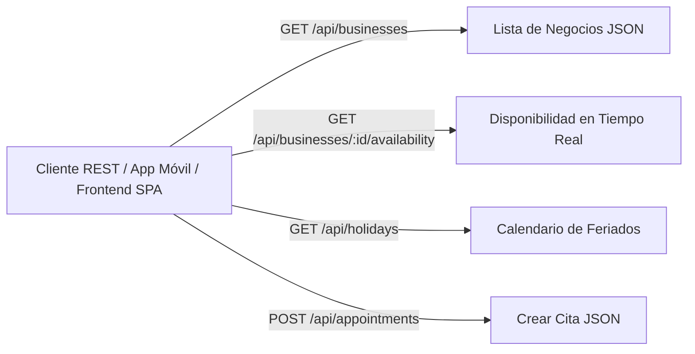

---
tags:
  - rutas
  - endpoints
  - api
  - middlewares
padre: "[[00 - MOC - Indice Maestro]]"
---

# 🛣️ 02 - Mapa de Rutas y Endpoints

Este documento mapea la totalidad de los puntos de entrada HTTP de la aplicación, divididos entre la interfaz web (`routes/web.php`) y la API REST interoperable (`routes/api.php`).

---

## 🌐 1. Rutas Web (`routes/web.php`)

### Públicas / Visitantes (`guest`)

| Método | URI | Nombre de Ruta | Controlador y Acción | Propósito |
| :--- | :--- | :--- | :--- | :--- |
| `GET` | `/` | `home` | `PublicBusinessController@index` | Catálogo de negocios activos con buscador |
| `GET` | `/negocios` | `public.businesses.index` | *Redirect a `/`* | Redirección amigable |
| `GET` | `/negocios/{business:slug}` | `public.businesses.show` | `PublicBusinessController@show` | Perfil del negocio con servicios, reseñas y marca personalizada |
| `GET` | `/register` | `register` | `RegisteredUserController@create` | Formulario de registro de nuevo usuario |
| `POST` | `/register` | - | `RegisteredUserController@store` | Guardar nuevo usuario |
| `GET` | `/login` | `login` | `AuthenticatedSessionController@create` | Formulario de inicio de sesión |
| `POST` | `/login` | - | `AuthenticatedSessionController@store` | Autenticar credenciales |
| `GET` | `/auth/google/redirect` | `auth.google.redirect` | `GoogleAuthController@redirect` | Redirección al proveedor OAuth Google |
| `GET` | `/auth/google/callback` | `auth.google.callback` | `GoogleAuthController@callback` | Retorno y login automático con Google |

---

### Autenticadas (`middleware: auth`)

| Método | URI | Nombre de Ruta | Controlador y Acción | Propósito |
| :--- | :--- | :--- | :--- | :--- |
| `POST` | `/logout` | `logout` | `AuthenticatedSessionController@destroy` | Cerrar sesión activa |
| `GET` | `/onboarding/profile` | `onboarding.profile.edit` | `ProfileOnboardingController@edit` | Completar datos obligatorios (nombre, celular) |
| `PUT` | `/onboarding/profile` | `onboarding.profile.update` | `ProfileOnboardingController@update` | Guardar datos de perfil completado |
| `GET` | `/business-access/request` | `business-access.create` | `BusinessAccessRequestController@create` | Formulario para solicitar ser Dueño de Negocio |
| `POST` | `/business-access/request` | `business-access.store` | `BusinessAccessRequestController@store` | Enviar solicitud de acceso |
| `GET` | `/business-access/pending` | `business-access.pending` | `BusinessAccessRequestController@pending` | Pantalla de espera de aprobación de cuenta |

---

### Perfil Completo (`middleware: auth, profile.completed`)

| Método | URI | Nombre de Ruta | Controlador y Acción | Propósito |
| :--- | :--- | :--- | :--- | :--- |
| `GET` | `/dashboard` | `dashboard` | `DashboardController` | Panel principal según rol (Cliente, Dueño o Admin) |
| `POST` | `/negocios/{business:slug}/resenas` | `public.businesses.reviews.store` | `BusinessReviewController@store` | Publicar reseña y calificación tras cita completada |
| `POST` | `/business-access/{user}/approve` | `business-access.approve` | `BusinessAccessRequestController@approve` | Admin aprueba solicitud de dueño de negocio |
| `GET` | `/appointments` | `appointments.index` | `AppointmentController@index` | Lista de citas (filtradas por rol de usuario) |
| `GET` | `/appointments/create` | `appointments.create` | `AppointmentController@create` | Formulario de agendamiento |
| `POST` | `/appointments` | `appointments.store` | `AppointmentController@store` | Confirmar y reservar nueva cita |
| `GET` | `/appointments/{appointment}/edit` | `appointments.edit` | `AppointmentController@edit` | Modificar cita existente |
| `PUT` | `/appointments/{appointment}` | `appointments.update` | `AppointmentController@update` | Guardar cambios en cita |
| `GET` | `/appointments/{appointment}/payment` | `appointments.payment.show` | `AppointmentController@showPayment` | Pantalla de pago de la cita |
| `POST` | `/appointments/{appointment}/payment` | `appointments.payment.process` | `AppointmentController@processPayment` | Procesar pago (Stripe/Simulado) |
| `PATCH` | `/appointments/{appointment}/status` | `appointments.status` | `AppointmentController@updateStatus` | Cambiar estado (confirmar, cancelar, completar) |
| `PATCH` | `/appointments/{appointment}/payment` | `appointments.payment` | `AppointmentController@updatePaymentStatus` | Actualizar estado manual del pago |

---

### Gestión de Negocio Aprobado (`middleware: auth, profile.completed, business.approved`)

| Método | URI | Nombre de Ruta | Controlador y Acción | Propósito |
| :--- | :--- | :--- | :--- | :--- |
| `POST` | `/holidays/sync` | `holidays.sync` | `HolidayController@sync` | Sincronizar feriados con API externa |
| `RESOURCE` | `/businesses` | `businesses.*` | `BusinessController` | CRUD del perfil del negocio y branding |
| `GET` | `/businesses/{b}/hours` | `businesses.hours.index` | `BusinessHourController@index` | Lista de horarios de atención del salón |
| `POST` | `/businesses/{b}/hours` | `businesses.hours.store` | `BusinessHourController@store` | Configurar apertura y cierre semanal |
| `PUT` | `/businesses/{b}/hours/{h}` | `businesses.hours.update` | `BusinessHourController@update` | Editar horario de un día específico |
| `GET` | `/businesses/{b}/services` | `businesses.services.index` | `ServiceController@index` | Catálogo de servicios del negocio |
| `POST` | `/businesses/{b}/services` | `businesses.services.store` | `ServiceController@store` | Crear nuevo servicio con fotos y precios |
| `PUT` | `/businesses/{b}/services/{s}` | `businesses.services.update` | `ServiceController@update` | Modificar servicio o galería |

---

## 📡 2. Rutas de la API REST (`routes/api.php`)

Diseñadas para **Interoperabilidad (Guía 2 & Guía 7)**:

### Endpoints Públicos de Consulta
- `GET /api/businesses`: Listado de negocios con servicios, ubicación y branding.
- `GET /api/businesses/{business}`: Información detallada de un negocio.
- `GET /api/businesses/{business}/services`: Catálogo de servicios ofertados.
- `GET /api/businesses/{business}/hours`: Horarios configurados por día de semana.
- `GET /api/businesses/{business}/availability`: Consulta de slots horarios disponibles para una fecha y servicio específico.
- `GET /api/holidays`: Lista de feriados cargados en el sistema.

### Endpoints Protegidos (`middleware: web, auth`)
- `GET /api/appointments`: Listado de citas del usuario autenticado en formato JSON.
- `POST /api/appointments`: Creación programática de citas mediante payload JSON.
- `PUT /api/appointments/{appointment}`: Reprogramación o actualización de una cita.
- `POST /api/holidays/sync`: Disparo de sincronización de feriados vía API.

---

## 🔗 Enlaces Relacionados
- MOC Principal: [[00 - MOC - Indice Maestro]]
- Controladores: [[01 - Arquitectura y Capas del Sistema]]
- Entidades Afectadas: [[entidades/Appointment]], [[entidades/Business]], [[entidades/Service]]
