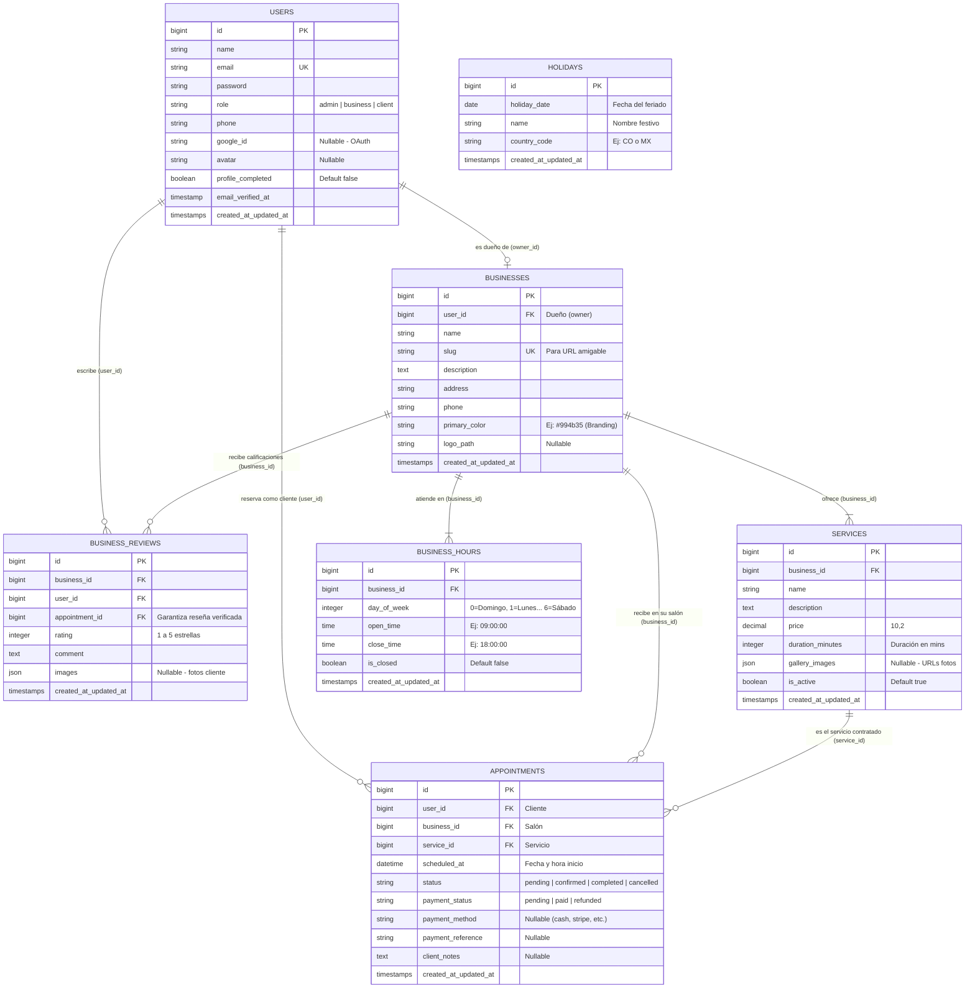

---
tags:
  - base-de-datos
  - esquema-er
  - eloquent
  - migraciones
padre: "[[00 - MOC - Indice Maestro]]"
---

# 🗄️ 03 - Modelo de Datos y Esquema ER

Este documento describe la estructura relacional de la base de datos de **citas-app**, sus entidades Eloquent, relaciones, llaves foráneas y el historial cronológico de migraciones.

---

## 📊 Diagrama Entidad-Relación (Mermaid ER)

---

## 🗃️ Detalle de Tablas y Atributos

### 1. `users`
- Almacena todos los actores del sistema: Clientes, Dueños de negocio (`business`) y Administradores (`admin`).
- Soporta inicio de sesión tradicional y **Google OAuth Socialite** mediante `google_id` y `avatar`.
- Controla el flujo de registro asistido mediante `profile_completed`.

### 2. `businesses`
- Representa cada salón, spa o centro de estética.
- Posee `slug` único para generación de URLs amigables (`/negocios/salon-elegancia`).
- Soporta personalización visual con `primary_color` (Hexadecimal) inyectado dinámicamente como variable CSS en frontend.

### 3. `services`
- Catálogo de tratamientos ofrecidos por un negocio (ej. Manicura, Masaje relajante, Corte).
- Atributo `duration_minutes` esencial para el cálculo de disponibilidad de la agenda.
- `gallery_images` (tipo JSON) almacena un array de rutas a fotos de trabajos previos para dar confianza al cliente.

### 4. `appointments`
- Núcleo transaccional de la plataforma.
- Estados de cita:
  - `pending`: Cita solicitada, pendiente de confirmación o pago.
  - `confirmed`: Aprobada y reservada en la agenda.
  - `completed`: Servicio finalizado satisfactoriamente (habilita publicar reseña).
  - `cancelled`: Cancelada por cliente o administrador.
- Estados financieros: `pending`, `paid`, `refunded`.

### 5. `business_hours`
- Matriz de disponibilidad semanal por salón (`day_of_week` de 0 a 6).
- Define `open_time`, `close_time` y bandera `is_closed`.

### 6. `holidays`
- Registro de días no laborables alimentados manual o externamente mediante [[05 - Servicios e Integraciones#HolidaySyncService|HolidaySyncService]].
- El motor de disponibilidad bloquea automáticamente estas fechas.

### 7. `business_reviews`
- Calificaciones (1-5 estrellas) y comentarios.
- Vinculado a `appointment_id` para garantizar que solo usuarios que realmente asistieron a una cita completada puedan calificar.

---

## 📜 Historial Cronológico de Migraciones

| Archivo de Migración | Tabla / Alteración | Propósito |
| :--- | :--- | :--- |
| `0001_01_01_000000_create_users_table.php` | `users`, `password_reset_tokens`, `sessions` | Estructura base de autenticación Laravel |
| `2026_03_16_155359_create_businesses_table.php` | `businesses` | Creación de salones y enlace con dueño `user_id` |
| `2026_03_16_160631_create_services_table.php` | `services` | Creación de catálogo de servicios por salón |
| `2026_03_17_150111_create_appointments_table.php` | `appointments` | Creación de tabla de citas de agenda |
| `2026_04_07_100000_create_business_hours_table.php` | `business_hours` | Horarios de apertura y cierre semanal |
| `2026_04_07_140000_add_payment_fields_to_appointments.php` | `appointments` | Agrega `payment_status`, `payment_method`, etc. |
| `2026_04_12_090000_create_holidays_table.php` | `holidays` | Gestión de días festivos e inhábiles |
| `2026_05_25_223500_add_social_and_onboarding_to_users.php` | `users` | Campos Google OAuth y `profile_completed` |
| `2026_05_25_223600_add_slug_and_primary_color_to_businesses.php` | `businesses` | Branding dinámico y URL slugs |
| `2026_05_27_080000_add_gallery_images_to_services.php` | `services` | Soporte para galería fotográfica de servicios |
| `2026_05_27_081500_create_business_reviews_table.php` | `business_reviews` | Reseñas verificadas y calificaciones |

---

## 🔗 Enlaces Relacionados
- MOC: [[00 - MOC - Indice Maestro]]
- Fichas de Modelos: [[entidades/User]], [[entidades/Business]], [[entidades/Appointment]], [[entidades/Service]]
- Flujo de Negocio: [[04 - Logica de Negocio y Flujos]]
