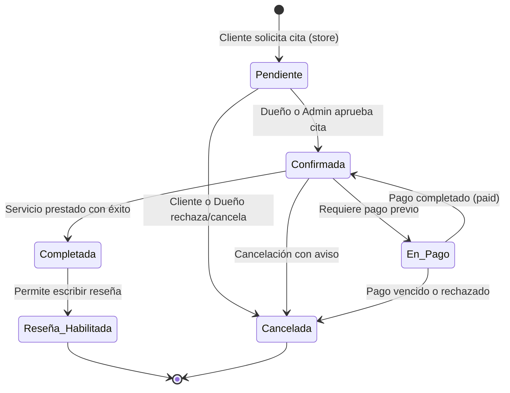
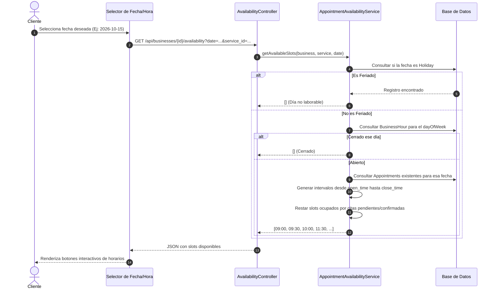
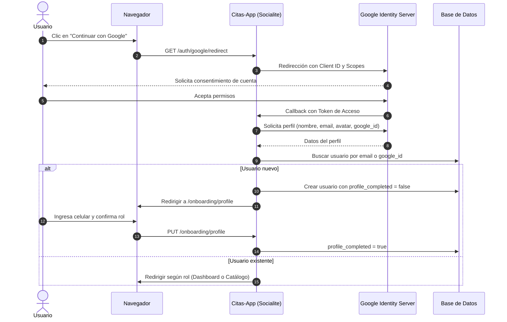

---
tags:
  - logica-de-negocio
  - flujos
  - maquina-de-estados
  - citas
padre: "[[00 - MOC - Indice Maestro]]"
---

# 🔄 04 - Lógica de Negocio y Flujos del Sistema

Este documento describe los flujos operativos clave de **citas-app**, incluyendo la máquina de estados de las citas, el cálculo de disponibilidad de agenda y el proceso de autenticación e inducción.

---

## 📅 1. Ciclo de Vida y Máquina de Estados de una Cita

### Reglas de Negocio en la Transición de Estados
1. **Creación**: Al registrar una cita, el sistema valida que no exista solapamiento horario con otra cita confirmada en el mismo salón para el mismo horario (`scheduled_at` + `duration_minutes`).
2. **Validación de Días Inhábiles**: Si la fecha solicitada coincide con un registro en la tabla `holidays`, el formulario bloquea la selección.
3. **Reseñas Verificadas**: Únicamente las citas en estado `completed` permiten disparar la ruta `public.businesses.reviews.store`. Esto previene reseñas fraudulentas.

---

## ⏱️ 2. Flujo de Cálculo de Disponibilidad

El servicio [[05 - Servicios e Integraciones#AppointmentAvailabilityService|AppointmentAvailabilityService]] ejecuta la siguiente lógica para generar las horas disponibles:

---

## 🔐 3. Flujo de Autenticación, Google OAuth y Onboarding

---

## 🔗 Enlaces Relacionados
- MOC Principal: [[00 - MOC - Indice Maestro]]
- Detalle de Entidad Cita: [[entidades/Appointment]]
- Endpoints: [[02 - Mapa de Rutas y Endpoints]]
