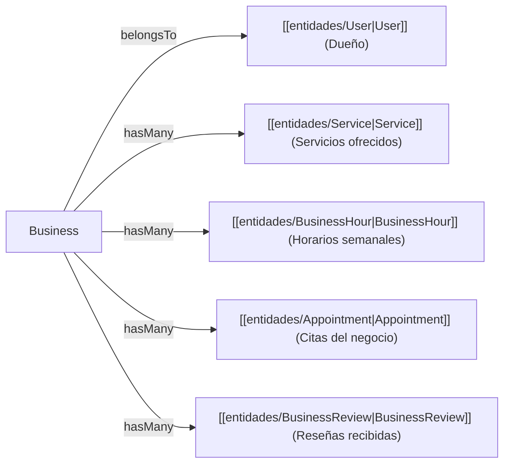

---
tags:
  - modelo
  - eloquent
  - entidad
  - negocio
padre: "[[03 - Modelo de Datos y Esquema ER]]"
---

# 🏢 Entidad Eloquent: Business

- **Archivo PHP**: `app/Models/Business.php`
- **Tabla en BD**: `businesses`

---

## 📋 Atributos y Fillable
| Campo | Tipo | Descripción |
| :--- | :--- | :--- |
| `id` | `bigint unsigned` | Llave primaria |
| `user_id` | `bigint unsigned` | Llave foránea al dueño en `users` |
| `name` | `string` | Nombre comercial del salón/spa |
| `slug` | `string (unique)` | Identificador amigable para URLs públicas |
| `description` | `text` | Descripción y especialidades del salón |
| `address` | `string` | Dirección física |
| `phone` | `string` | Teléfono del negocio |
| `primary_color` | `string` | Color corporativo en hexadecimal (`#RRGGBB`) |
| `logo_path` | `string (nullable)` | Ruta al logotipo |

---

## 🔗 Relaciones Eloquent

## 🎨 Branding Dinámico
El método helper o accessor de `primary_color` provee un color seguro con fallback para contrastar adecuadamente en el template Blade con `--primary-color`.
