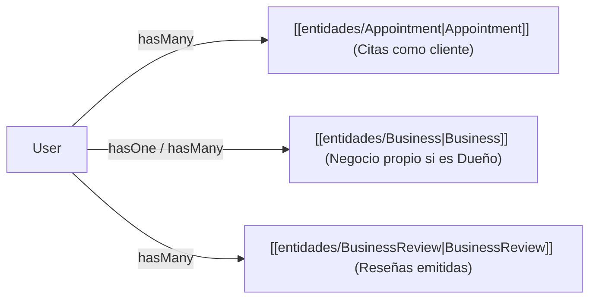

---
tags:
  - modelo
  - eloquent
  - entidad
  - auth
padre: "[[03 - Modelo de Datos y Esquema ER]]"
---

# 👤 Entidad Eloquent: User

- **Archivo PHP**: `app/Models/User.php`
- **Tabla en BD**: `users`
- **Traits Usados**: `HasFactory`, `Notifiable`

---

## 📋 Atributos y Fillable
| Campo | Tipo | Descripción |
| :--- | :--- | :--- |
| `id` | `bigint unsigned` | Llave primaria |
| `name` | `string` | Nombre del usuario |
| `email` | `string` | Correo electrónico único |
| `password` | `string` | Contraseña cifrada con Bcrypt/Argon2 |
| `role` | `string` | Rol del sistema: `client`, `business`, `admin` |
| `phone` | `string` | Celular de contacto para recordatorios |
| `google_id` | `string (nullable)` | ID único devuelto por Google OAuth |
| `avatar` | `string (nullable)` | URL a foto de perfil |
| `profile_completed` | `boolean` | Flag que indica si terminó onboarding |

---

## 🔗 Relaciones Eloquent

## 🛠️ Métodos y Scopes Clave
- `isAdmin(): bool`: Comprueba si el rol es `admin`.
- `isBusiness(): bool`: Comprueba si el usuario tiene rol o acceso de dueño de salón.
- `isClient(): bool`: Comprueba si es cliente final.
- `appointments()`: Retorna colección de citas del usuario ordenadas cronológicamente.
